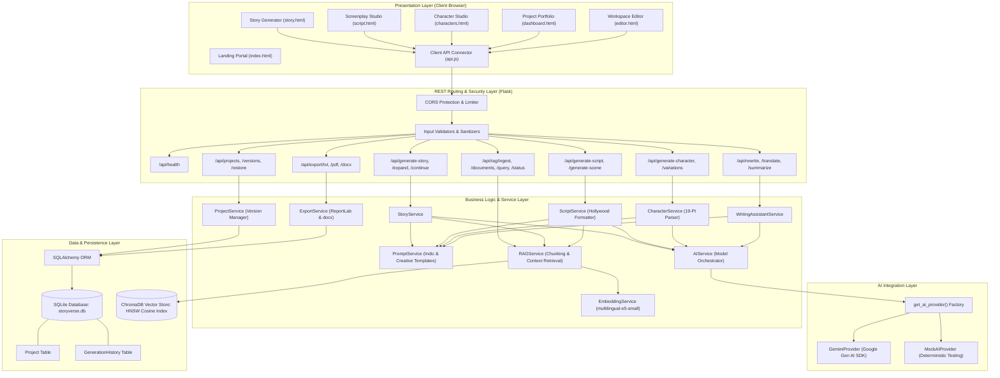
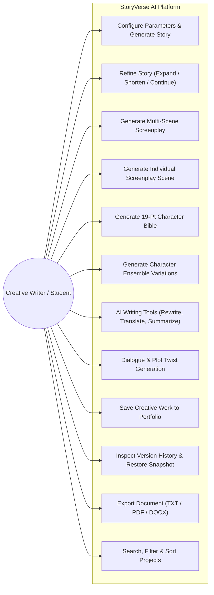
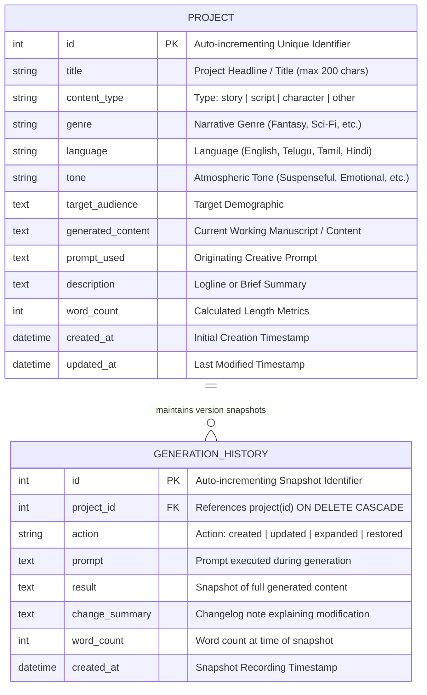
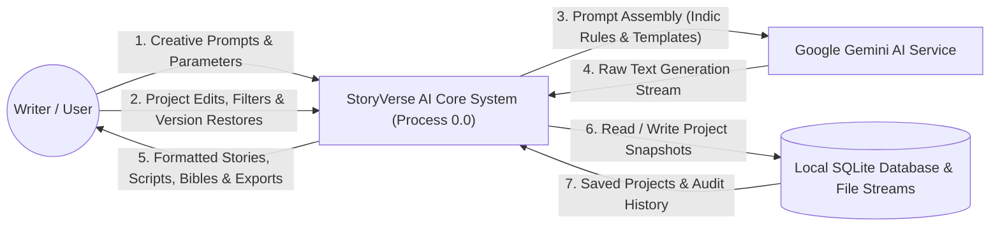
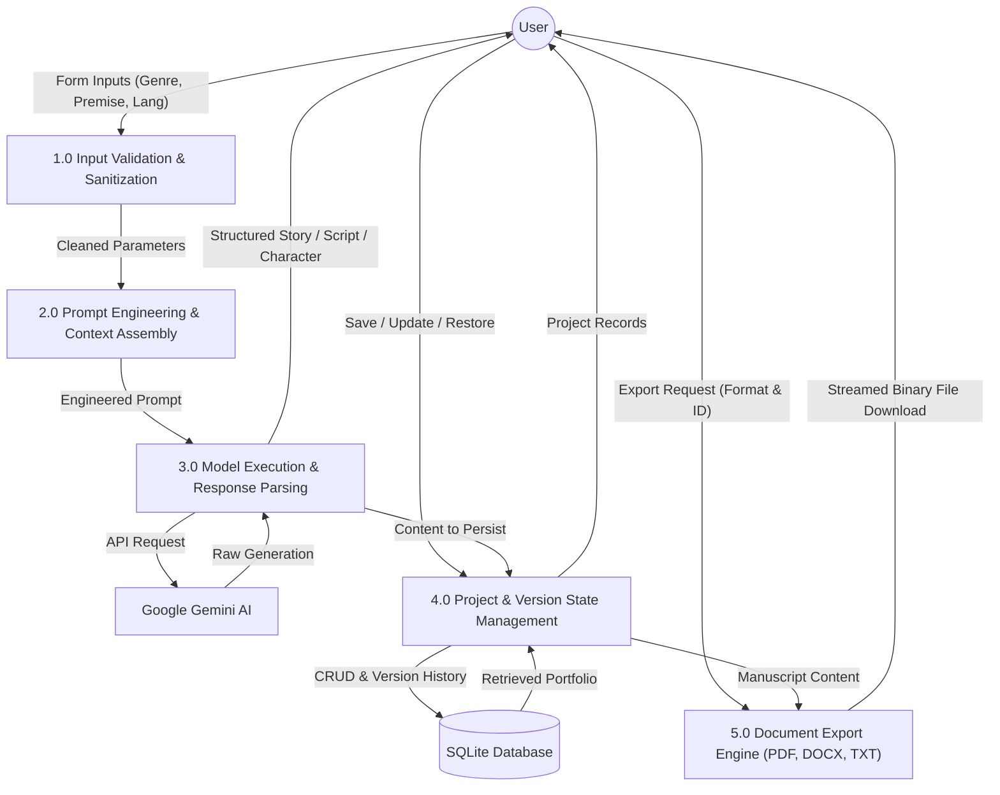
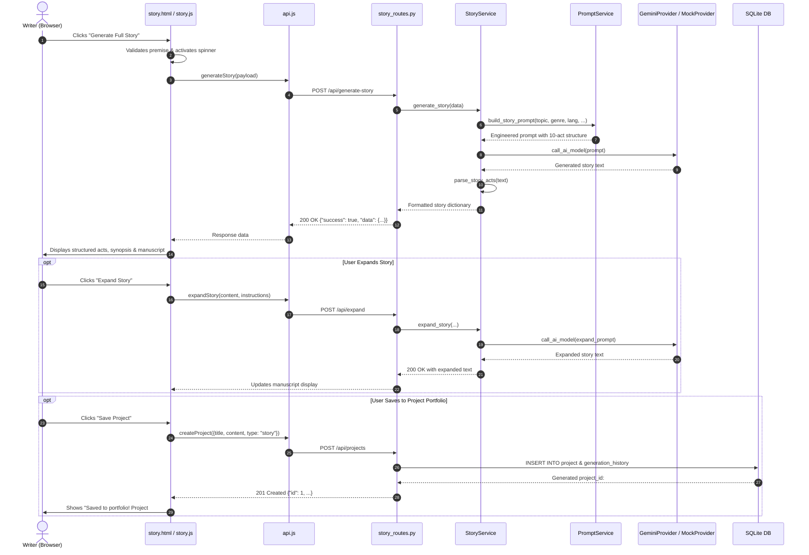
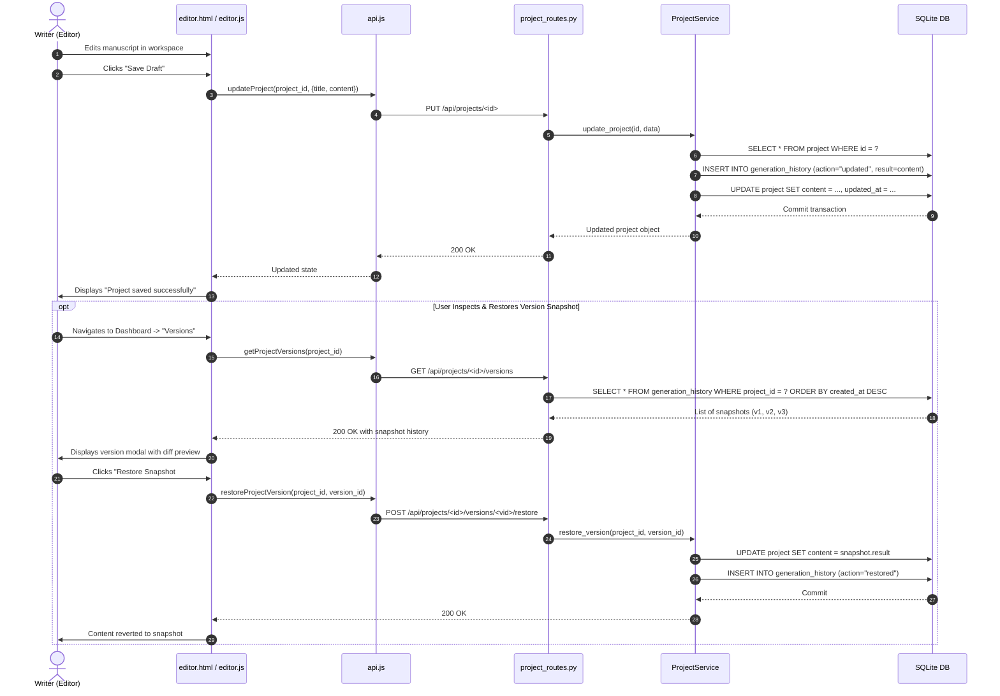
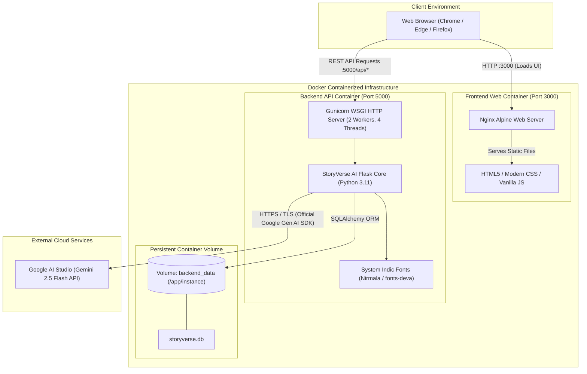

# StoryVerse AI — Complete System Diagrams
**Project:** Story and Script Generator Using Generative AI  
**Academic Role:** Final Year B.Tech Computer Science Project  
**Date:** November 2026  

---

## 1. System Architecture Diagram

This diagram visualizes the multi-tier client-server architecture of StoryVerse AI, illustrating the presentation layer, the REST routing layer, application services, persistence, and external AI integrations.



---

## 2. Use Case Diagram

Visualizes user interactions across creative generation, workspace editing, portfolio management, and multi-format document exporting.



---

## 3. Entity-Relationship (ER) Diagram

Details database entities, data types, primary keys, foreign keys, and relationship cardinalities between `project` and `generation_history`.



---

## 4. Data Flow Diagram (DFD) Level 0 — Context Diagram

Illustrates the boundary of StoryVerse AI with external entities (User and Generative AI Model).



---

## 5. Data Flow Diagram (DFD) Level 1 — Subsystem Breakdown

Decomposes the Level 0 process into specific functional sub-processes.



---

## 6. Activity Diagram — Creative Generation Workflow

Visualizes decision logic and operational branches during story/script generation.

```mermaid
flowchart TD
    Start([User Begins Generation]) --> Input[Fill in Premise, Genre, Language, Tone]
    Input --> Validate{Validate Input Schema?}
    
    Validate -- "Validation Failed" --> ErrMsg[Display Inline Field Errors & Toast]
    ErrMsg --> Input

    Validate -- "Input Valid" --> Load[Show Loading State & Clapperboard Animation]
    Load --> BuildPrompt[Build Structured Prompt with Indic & Formatting Rules]
    BuildPrompt --> CheckProv{Select AI Provider}

    CheckProv -- "AI_MOCK_MODE=true" --> ExecMock[Generate Deterministic Mock Content]
    CheckProv -- "AI_MOCK_MODE=false" --> ExecGemini[Execute Google Gen AI SDK Call]

    ExecGemini --> CheckAPI{API Response OK?}
    CheckAPI -- "Rate Limit (429) / Timeout (504)" --> APIErr[Handle Error Gracefully & Show User Toast]
    APIErr --> Stop([End Turn])

    CheckAPI -- "Success" --> ParseResp[Parse Content into Structured Dimensions]
    ExecMock --> ParseResp

    ParseResp --> Render[Render Dynamic UI: Badges, Scenes, Character Cards]
    Render --> Options{User Next Action}

    Options -- "Refine / Expand" --> Expand[Trigger /api/expand or /api/generate-scene]
    Expand --> Load

    Options -- "Save to Database" --> SaveDB[POST /api/projects]
    SaveDB --> Toast[Display Success Toast & Project ID]

    Options -- "Export Document" --> Export[Trigger /api/export/{fmt}]
    Export --> Download[Trigger In-Memory Browser File Download]

    Toast --> End([Complete])
    Download --> End
```

---

## 7. Sequence Diagram — Story Generation & Expansion

Details the chronological message flow between client, routes, services, prompt builder, AI model, and database.



---

## 8. Sequence Diagram — Project Persistence & Version Snapshot

Details how workspace revisions, version snapshotting, and snapshot restoration function.



---

## 9. Deployment Architecture Diagram

Illustrates both local standalone deployment and containerized Docker production deployment.



---

## 10. RAG Retrieval & Prompt Grounding Sequence Diagram

Illustrates the end-to-end vector knowledge ingestion, semantic cosine similarity retrieval via ChromaDB and SentenceTransformers, and generative prompt grounding for Google Gemini.

```mermaid
sequenceDiagram
    autonumber
    actor User as Author / Student
    participant Browser as Client Browser (story.html)
    participant Flask as Flask REST API (/api/generate-story)
    participant StorySvc as StoryService
    participant RAG as RAGService
    participant Embed as EmbeddingService (multilingual-e5-small)
    participant Chroma as ChromaDB Vector Store
    participant PromptSvc as PromptService
    participant Gemini as GeminiProvider (Google Gemini API)

    User->>Browser: Enter Premise + Check "Enable RAG Knowledge Grounding"
    Browser->>Flask: POST /api/generate-story {topic, use_rag: true, genre, language}
    Flask->>StorySvc: generate_story(params)
    
    alt use_rag is True
        StorySvc->>RAG: retrieve_context(query=topic, n_results=3, genre, language)
        RAG->>Embed: encode_query(topic)
        Embed-->>RAG: 384-dimensional dense vector
        RAG->>Chroma: query(query_embeddings, n_results=3, where_filter)
        Chroma-->>RAG: Top matching lore chunks with cosine distance
        RAG-->>StorySvc: List of retrieved context chunks
        StorySvc->>PromptSvc: build_rag_context_block(retrieved_chunks)
        PromptSvc-->>StorySvc: Formatted ground-truth instruction block
    end

    StorySvc->>PromptSvc: build_story_prompt(params with rag_context)
    PromptSvc-->>StorySvc: Grounded prompt containing lore facts + mandatory directives
    StorySvc->>Gemini: call_ai_model(grounded_prompt)
    Gemini-->>StorySvc: Generated story strictly adhering to retrieved canon lore
    StorySvc->>StorySvc: parse_story_sections(raw_text)
    StorySvc-->>Flask: Complete story sections + retrieved_context chunks + metadata
    Flask-->>Browser: HTTP 200 OK (JSON response)
    Browser->>User: Displays structured story + RAG Knowledge Grounding Chips

